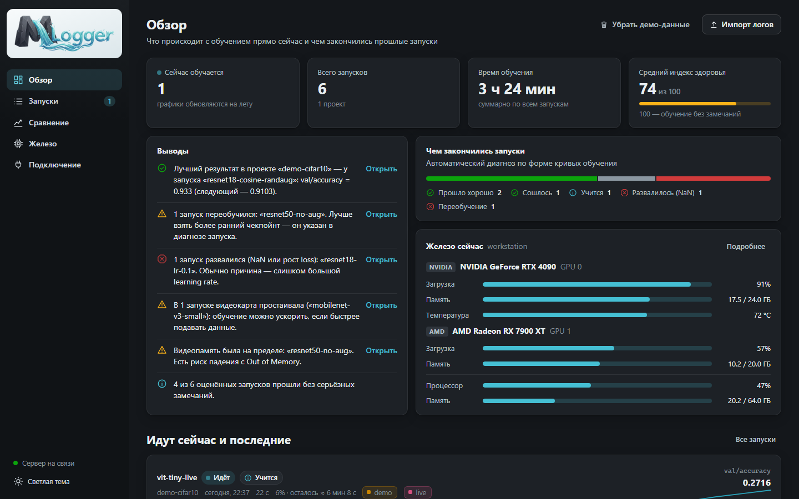
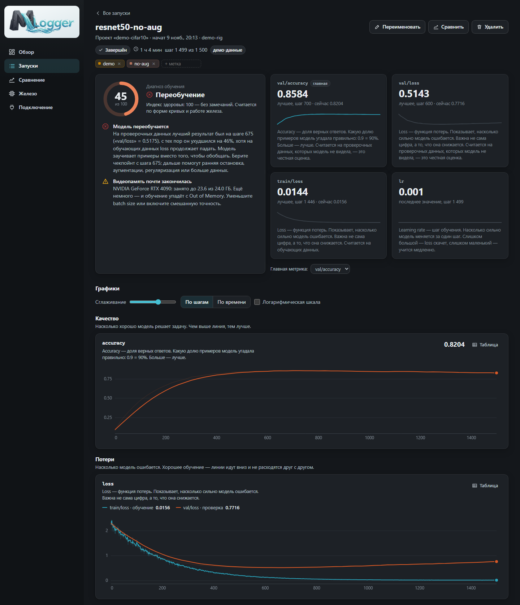
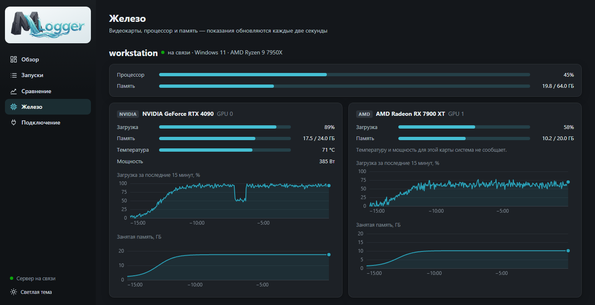
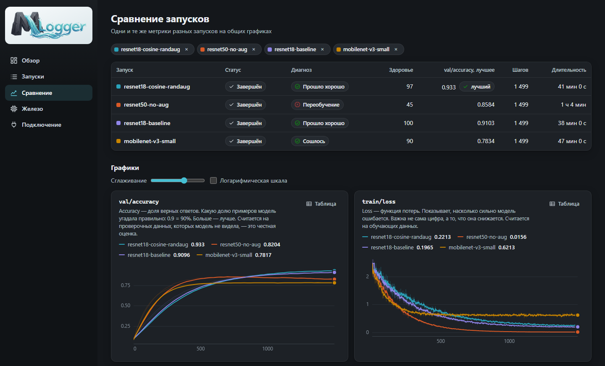
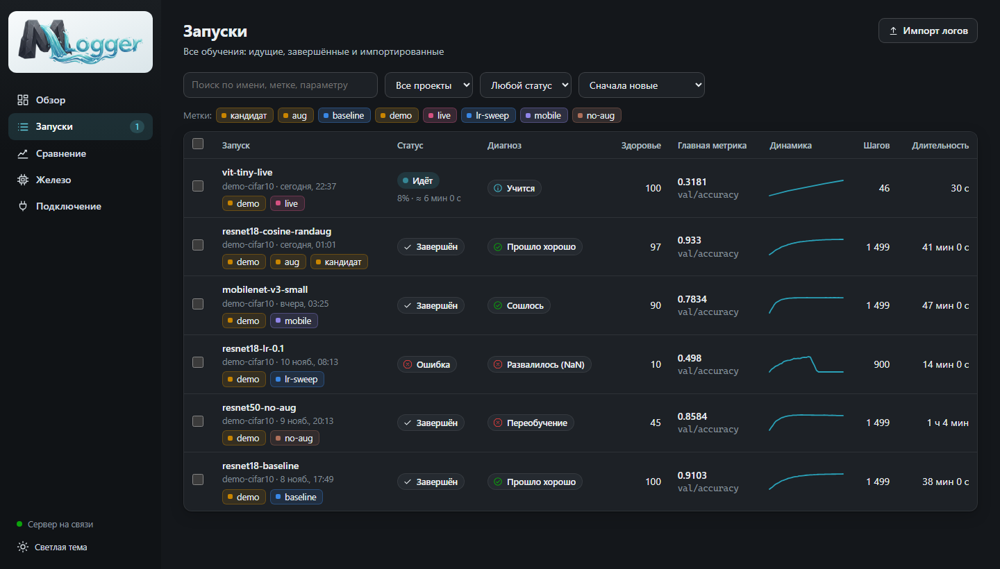

<div align="center">
<a href="https://github.com/charleemagn/mlogger">

</a>
</div>

<div align="center">

[](https://github.com/charleemagn/mlogger/actions/workflows/test-python.yml)
[](https://www.python.org/downloads/)
[](#installation)
[](LICENSE)

[Installation](#installation)
| [First Run](#tracking-your-first-run)
| [Integrations](#framework-integrations)
| [Examples](demo/)
| [Contributing](CONTRIBUTING.md)
| [Русская версия](readme_files/README_ru.md)

</div>

# MLogger: Track ML Training Locally — and Understand What You See

MLogger is an open-source experiment tracker that runs entirely on your own machine. It **records** the metrics of your training runs, **watches** your GPUs, and **explains in plain language** what is going on: the model is learning, overfitting, stuck on a plateau, or has blown up. No account, no cloud, no dependencies — just Python.



It takes three lines of Python to connect a training script, so let's get started.

### Installation

**Prerequisite**: MLogger requires [Python 3.9 or higher](https://www.python.org/downloads/). Nothing else — there is no `pip install` step for the server.

Download the project (**Code → Download ZIP** on GitHub, or clone it):

```bash
git clone https://github.com/charleemagn/mlogger.git
```

Then start it:

- **Windows** — double-click `start.bat`
- **Linux / macOS** — run `./start.sh`

Your browser opens the interface at <http://127.0.0.1:8765>.

> [!TIP]
> No training script at hand? Click **«Посмотреть на демо-данных»** on the first screen. It adds six demo runs that cover the typical scenarios — one of them keeps training live while you watch.

### Tracking Your First Run

Install the client into the Python environment your training runs in. It is a tiny package with no dependencies:

```bash
pip install path/to/mlogger/sdk
```

Add MLogger to your training loop:

```python
import mlogger

run = mlogger.init(
    project="cifar10",
    config={"lr": 3e-4, "batch_size": 64},
    tags=["baseline"],
    total_steps=20,
)

for epoch in range(20):
    ...
    run.log({"train/loss": train_loss, "val/loss": val_loss, "val/accuracy": acc}, step=epoch + 1)

run.finish()
```

Run your script. The run appears in the interface immediately and its charts update live:



> [!TIP]
> Name your metrics `train/...` and `val/...` (or `train_loss`, `val_loss`). MLogger then draws them on one chart and can detect overfitting. `log()` accepts plain numbers, NumPy scalars and tensors.

The client never gets in the way of training: it sends data from a background thread, and if the server is not running, the metrics are saved to disk and uploaded the next time you start a run. To try everything without your own code, run `python demo/quickstart.py`.

### Understanding the Diagnosis

Every run gets a **verdict** and a **health score** from 0 to 100, computed from the shape of its curves and from hardware readings:

| Verdict | What it means |
|---|---|
| Learning / Went well | the metric keeps improving, nothing to worry about |
| Converged | the metric reached a level and stopped changing |
| Plateau | a running job has not improved for a long time — you can stop it |
| Overfitting | validation got worse while the training loss keeps falling |
| Unstable | the loss jumps a lot from step to step |
| Not learning | the loss has not gone down since the start |
| Diverging / Blew up | the loss is growing or turned into NaN |

Each verdict comes with an explanation and a next step, for example *"the best validation result was at step 675 — take the checkpoint from there"* or *"the GPU is idle — your data loader is too slow"*. The score is a heuristic: it tells you where to look and does not replace looking at the charts.

### An Overview of MLogger

#### Any GPU, any number of them

| GPU | OS | What you get |
|---|---|---|
| NVIDIA | Windows, Linux | utilization, memory, temperature, power (via `nvidia-smi`, shipped with the driver) |
| AMD, Intel and others | Windows 10/11 | utilization and memory — the same counters Task Manager uses |
| AMD | Linux | utilization, memory, temperature, power (`amdgpu` driver) |

Hardware history is recorded only while a run is in progress and is attached to that run, so you can see how each card was loaded during training. Check what the monitor sees with `python -m monitor`.



#### Comparing runs

Select several runs and put the same metrics on shared charts, next to a table of the hyperparameters that differ.



#### Tags, search and filters

Give runs colored tags in code or in the interface, then filter by tag, project and status, or search by name and hyperparameters.



#### Importing existing logs

No code changes needed if you already have logs. MLogger reads Ultralytics `results.csv`, TensorBoard event files (written by PyTorch Lightning, Keras, Transformers) and MLflow `mlruns` folders:

```bash
python start.py import path/to/runs/detect/train
```

#### Training on another machine

Start the server with `python start.py --host 0.0.0.0`, point the client at it with `mlogger.init(url="http://server:8765")` or the `MLOGGER_URL` environment variable, and run the hardware monitor on the training machine:

```bash
python -m monitor --server http://server:8765
```

> [!WARNING]
> With `--host 0.0.0.0` the server is open to your local network and is **not password-protected**. Use it only on a network you trust.

### Framework Integrations

`run.log({...})` works with any framework. For the popular ones there are ready-made wrappers:

| Framework | How to connect |
|---|---|
| Keras / TensorFlow | `model.fit(..., callbacks=[MLoggerCallback(project="...")])` from `mlogger.integrations.keras` |
| PyTorch Lightning | `Trainer(logger=MLoggerLogger(project="..."))` from `mlogger.integrations.lightning` |
| Ultralytics YOLO | `add_mlogger(model, project="...")` from `mlogger.integrations.ultralytics` |
| Hugging Face Trainer | `Trainer(..., callbacks=[MLoggerCallback(project="...")])` from `mlogger.integrations.transformers` |
| XGBoost | `xgb.train(..., callbacks=[MLoggerCallback(project="...")])` from `mlogger.integrations.xgboost` |
| LightGBM | `lgb.train(..., callbacks=[mlogger_callback(run)])` from `mlogger.integrations.lightgbm` |

Full snippets are on the **«Подключение»** page of the interface. The wrappers are thin; if one misbehaves with your framework version, please [open an issue](https://github.com/charleemagn/mlogger/issues/new/choose).

### Command Line

```
start.bat                           start the server and open the interface
python start.py --port 9000         use another port
python start.py --host 0.0.0.0      accept data from other machines
python start.py --no-browser        do not open the browser
python start.py --data D:\mlogger   keep the database in another folder
python start.py import <folder>     import existing logs
python start.py demo                add demo runs
python -m monitor                   show which GPUs the monitor sees
python -m unittest discover test    run the tests
```

Everything is stored in a single SQLite file, `data/mlogger.db`, inside the project folder. Delete the `data` folder to start from scratch, or copy it to move your history to another computer.

### What's Next?

- Browse the [examples](demo/): a dependency-free quickstart and a plain PyTorch training loop.
- Read [CONTRIBUTING.md](CONTRIBUTING.md) to learn how the repository is organized and how to run the tests.
- See [CHANGELOG.md](CHANGELOG.md) for what is in the current release.

The interface is currently available in Russian; this README is also available [in Russian](readme_files/README_ru.md).

## Questions?

If you'd like to report a bug or have a feature request, please create an [issue on GitHub](https://github.com/charleemagn/mlogger/issues/new/choose).

If you like MLogger, please leave a ⭐ on GitHub!

## Open Source Stack

MLogger deliberately has no third-party dependencies. It is built on:

- the [Python](https://www.python.org) standard library — the HTTP server, the client and the hardware monitor
- [SQLite](https://www.sqlite.org) — storage, in a single file
- plain JavaScript, HTML and CSS — the interface, with no build step

## License

MLogger is licensed under the GNU General Public License v3.0 found in the [LICENSE](LICENSE) file in the root directory of this repository.

## Citation

If you use MLogger in your work, you can cite it using the metadata in [CITATION.cff](CITATION.cff):

```
@software{mlogger,
  title = {MLogger: A Local Tracker for Machine Learning Training},
  author = {{MLogger contributors}},
  url = {https://github.com/charleemagn/mlogger},
  year = {2026},
}
```
