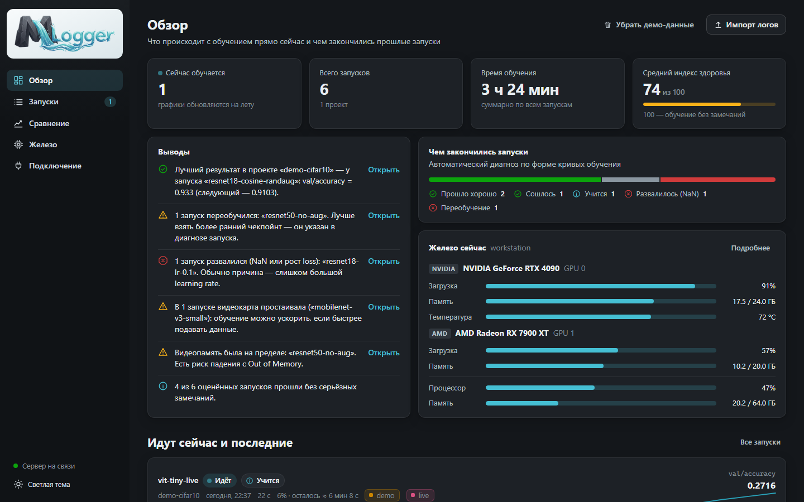
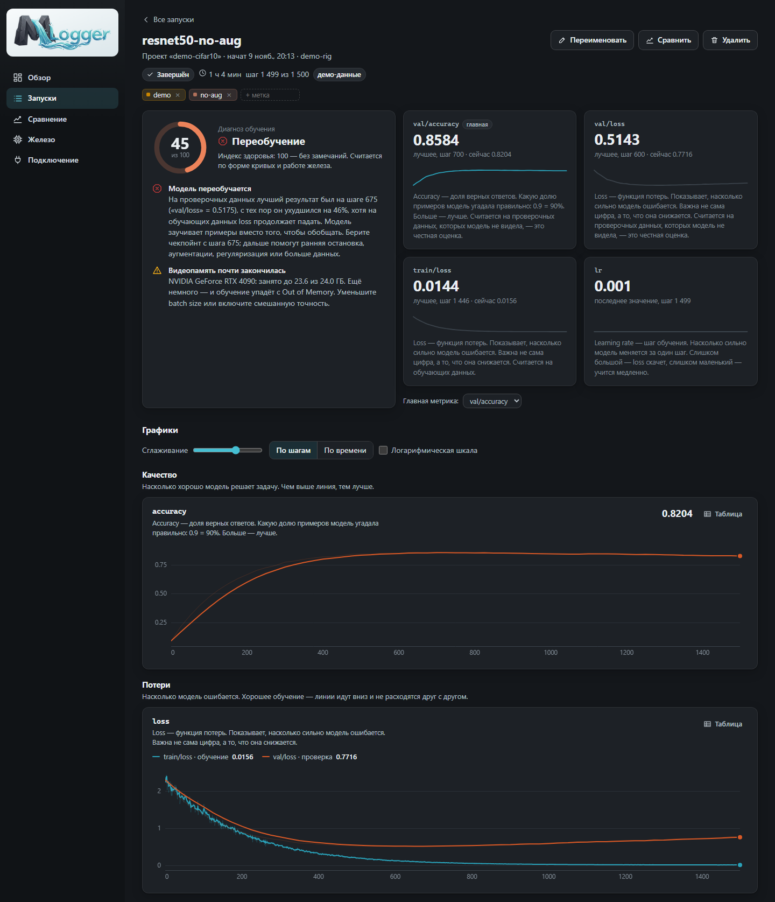
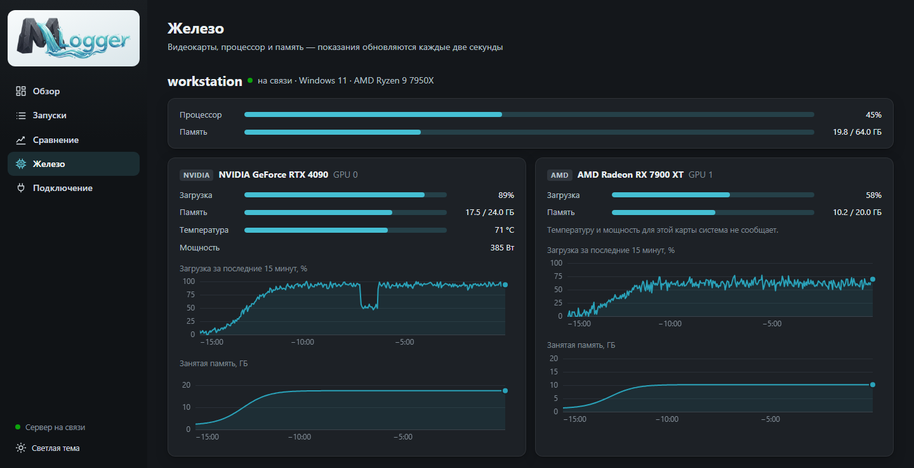

# MLogger — локальный трекер обучения ML-моделей

<div align="center">


[English](../README.md) | Русский

</div>

MLogger показывает, как идёт обучение модели: рисует графики метрик, следит за видеокартами и **объясняет простыми
словами, что происходит** — модель учится, переобучается, вышла на плато или развалилась. Всё работает на вашем
компьютере: данные никуда не отправляются, регистрация не нужна.

- **Ставится одним щелчком.** Нужен только Python 3.9+. Никаких `pip install`, Docker и баз данных.
- **Любые модели.** PyTorch, TensorFlow/Keras, Lightning, Ultralytics YOLO, Hugging Face, XGBoost, LightGBM — или
  просто `run.log({...})` из собственного цикла.
- **Любые видеокарты.** NVIDIA, AMD, Intel; несколько карт и несколько машин одновременно.
- **Диагноз обучения.** Индекс здоровья 0–100 и замечания человеческим языком: «переобучение с шага 550 — берите
  чекпойнт оттуда», «видеокарта простаивает — данные готовятся слишком медленно».
- **Метки, поиск, сравнение.** Цветные метки, фильтры, сравнение запусков на общих графиках и по параметрам.
- **Импорт готовых логов.** Ultralytics `results.csv`, TensorBoard, MLflow — без изменения кода обучения.



## Быстрый старт (Windows)

1. Установите [Python](https://www.python.org/downloads/) 3.9 или новее, если его ещё нет
   (при установке отметьте «Add python.exe to PATH»).
2. Скачайте проект: зелёная кнопка **Code → Download ZIP** на GitHub и распакуйте архив, либо

   ```
   git clone https://github.com/charleemagn/mlogger.git
   ```

3. Дважды щёлкните **`start.bat`**.

Откроется браузер с интерфейсом по адресу <http://127.0.0.1:8765>. На первом экране есть кнопка
«Посмотреть на демо-данных» — она добавит несколько запусков с разными сценариями, один из них «обучается» на глазах.

На Linux и macOS: `./start.sh` или `python3 start.py`.

## Как подключить своё обучение

Установите клиент в то окружение Python, где запускается обучение (пакет без зависимостей):

```
pip install путь\к\mlogger\sdk
```

Добавьте три строки в код:

```python
import mlogger

run = mlogger.init(
    project="cifar10",                       # одна задача — один проект
    config={"lr": 3e-4, "batch_size": 64},   # гиперпараметры
    tags=["baseline"],                       # метки для поиска
    total_steps=20,                          # тогда появятся прогресс и оставшееся время
)

for epoch in range(20):
    ...
    run.log({"train/loss": train_loss, "val/loss": val_loss, "val/accuracy": acc}, step=epoch + 1)

run.finish()
```

В `log()` можно передавать обычные числа, numpy-скаляры и тензоры. Называйте метрики `train/...` и `val/...`
(или `train_loss`, `val_loss`) — тогда они попадут на один график, а MLogger сможет заметить переобучение.

Клиент не мешает обучению: отправка идёт в фоне, а если сервер выключен, метрики сохраняются и
загружаются при следующем запуске. Проверить всё без своего кода можно примером: `python demo/quickstart.py`.



### Готовые обёртки

| Фреймворк | Как подключить |
|---|---|
| Keras / TensorFlow | `model.fit(..., callbacks=[MLoggerCallback(project="...")])` из `mlogger.integrations.keras` |
| PyTorch Lightning | `Trainer(logger=MLoggerLogger(project="..."))` из `mlogger.integrations.lightning` |
| Ultralytics YOLO | `add_mlogger(model, project="...")` из `mlogger.integrations.ultralytics` |
| Hugging Face Trainer | `Trainer(..., callbacks=[MLoggerCallback(project="...")])` из `mlogger.integrations.transformers` |
| XGBoost | `xgb.train(..., callbacks=[MLoggerCallback(project="...")])` из `mlogger.integrations.xgboost` |
| LightGBM | `lgb.train(..., callbacks=[mlogger_callback(run)])` из `mlogger.integrations.lightgbm` |

Полные примеры — в интерфейсе, в разделе «Подключение».

### Уже есть логи?

```
python start.py import C:\проекты\yolo\runs\detect\train
```

или кнопка «Импорт логов» в интерфейсе. Формат определяется автоматически.

## Видеокарты

| Карта | Система | Что показывается |
|---|---|---|
| NVIDIA | Windows, Linux | загрузка, память, температура, мощность (через `nvidia-smi`, он ставится с драйвером) |
| AMD, Intel и другие | Windows 10/11 | загрузка и память — те же счётчики, что в Диспетчере задач |
| AMD | Linux | загрузка, память, температура, мощность (драйвер `amdgpu`) |

Температуру и мощность для карт не от NVIDIA Windows сама не сообщает. Проверить, что видит монитор:
`python -m monitor`.

Показания записываются в историю только пока идёт обучение, и привязываются к запуску — на странице запуска видно,
как была загружена каждая карта.



**Обучение на другом компьютере.** Запустите сервер с `python start.py --host 0.0.0.0`, на машине с обучением
укажите адрес сервера (`mlogger.init(url="http://адрес:8765")` или переменная `MLOGGER_URL`) и запустите там монитор
из папки проекта: `python -m monitor --server http://адрес:8765`.

## Как читать диагноз

MLogger смотрит на форму кривых и работу железа и выносит вердикт:

| Вердикт | Что это значит |
|---|---|
| Учится / Прошло хорошо | метрика улучшается, замечаний нет |
| Сошлось | метрика вышла на уровень и перестала меняться |
| Плато | идущий запуск давно не улучшается — можно останавливать |
| Переобучение | на проверочных данных стало хуже, хотя на обучающих loss падает |
| Нестабильно | loss сильно скачет от шага к шагу |
| Не учится | loss не снижается с самого начала |
| Расходится / Развалилось | loss растёт или превратился в NaN |

**Индекс здоровья** — число от 0 до 100: из ста вычитаются штрафы за каждое замечание. Это эвристика,
а не точная наука: она подсказывает, куда посмотреть, и не заменяет взгляд на графики.

## Команды

```
start.bat                           запустить сервер и открыть интерфейс
python start.py --port 9000         другой порт
python start.py --host 0.0.0.0      принимать данные с других машин
python start.py --no-browser        не открывать браузер
python start.py --data D:\mlogger   хранить базу в другой папке
python start.py import <папка>      импортировать логи
python start.py demo                добавить демо-запуски
python -m monitor                   показать, какие видеокарты видит монитор
python -m unittest discover test    запустить тесты
```

## Где лежат данные

Всё хранится в одном файле `data/mlogger.db` (SQLite) в папке проекта. Чтобы начать с чистого листа, удалите папку
`data`; чтобы перенести историю на другой компьютер — скопируйте её.

## Безопасность

По умолчанию сервер доступен только с этого компьютера. С `--host 0.0.0.0` он открыт всей локальной сети и
**не защищён паролем** — используйте этот режим только в сети, которой доверяете.

## Устройство проекта

```
start.py, start.bat   запуск
server/               HTTP-сервер и хранилище (стандартная библиотека Python + SQLite)
ui/                   веб-интерфейс (чистый JavaScript, без сборки)
sdk/                  клиент для кода обучения: пакет mlogger и обёртки для фреймворков
monitor/              монитор видеокарт, процессора и памяти
diagnostics/          диагноз обучения и словарь метрик
importers/            импорт логов Ultralytics, TensorBoard и MLflow
demo/                 примеры
test/                 тесты
readme_files/         картинки для README и русская версия
```

## Лицензия

GPL-3.0, см. [LICENSE](../LICENSE).
