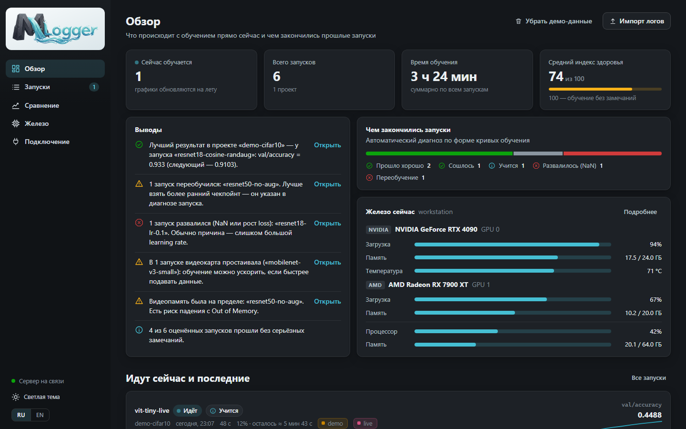
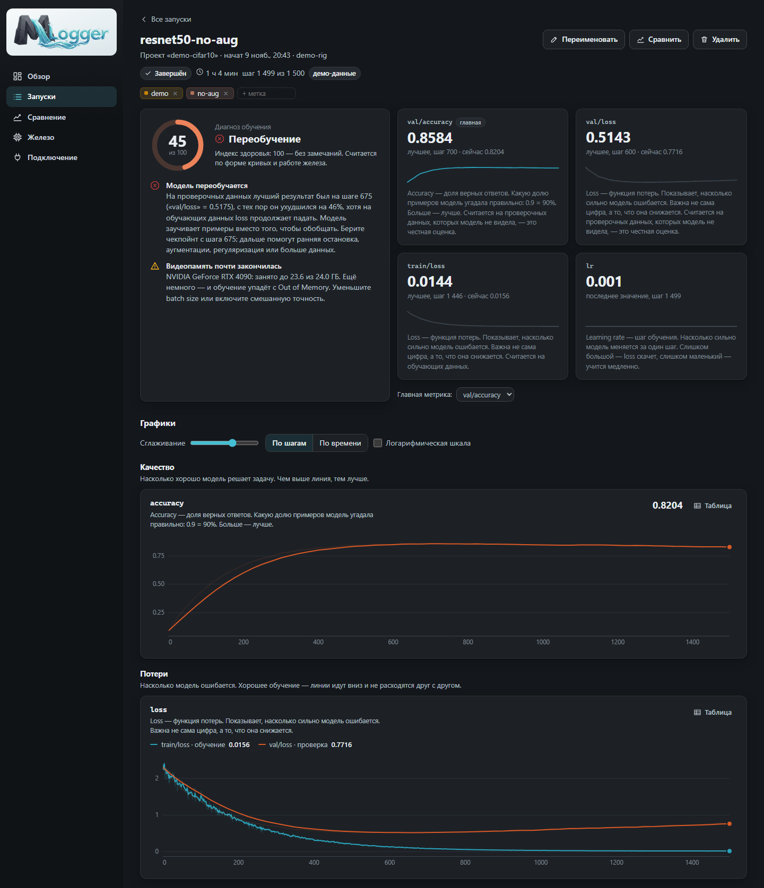
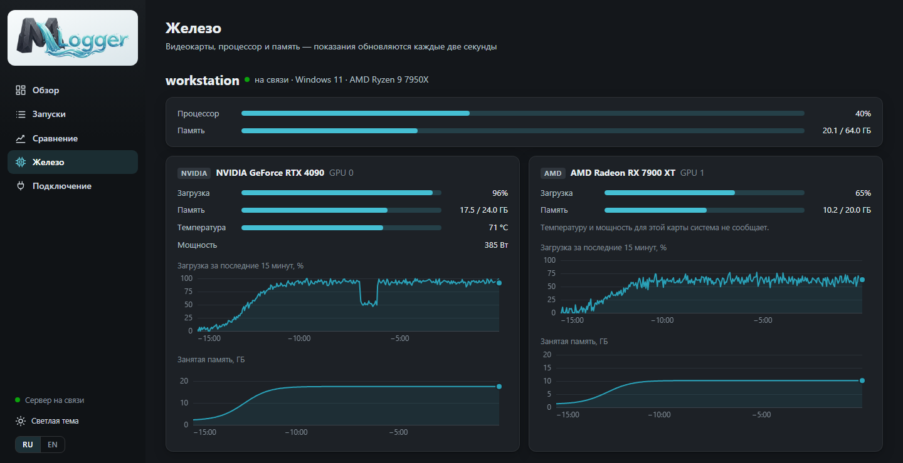
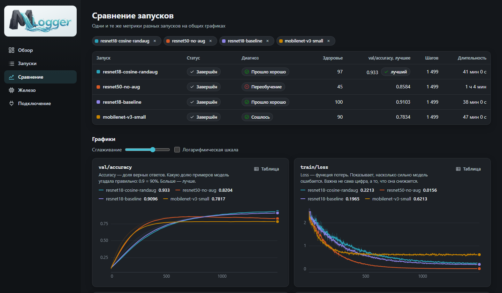
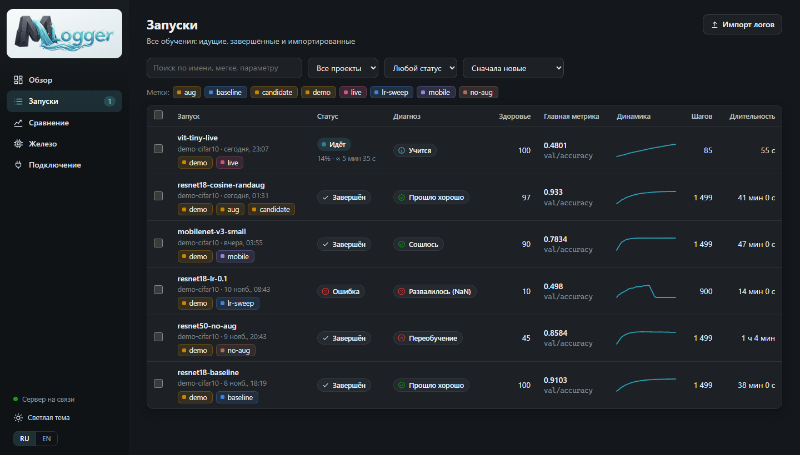

<div align="center">
<a href="https://github.com/charleemagn/mlogger">

</a>
</div>

<div align="center">

[English](../../README.md) | **Русский**

</div>

<div align="center">

[](https://github.com/charleemagn/mlogger/actions/workflows/test-python.yml)
[](https://www.python.org/downloads/)
[](#установка)
[](../../LICENSE)

[Установка](#установка)
| [Первый запуск](#первый-запуск)
| [Интеграции](#интеграции-с-фреймворками)
| [Примеры](../../demo/)
| [Участие в разработке](../../CONTRIBUTING.md)

</div>

# MLogger: следите за обучением моделей локально — и понимайте, что видите

MLogger — открытый трекер экспериментов, который целиком работает на вашем компьютере. Он **записывает** метрики обучения, **следит** за видеокартами и **объясняет простыми словами**, что происходит: модель учится, переобучается, вышла на плато или развалилась. Без регистрации, без облака, без зависимостей — нужен только Python.



Чтобы подключить скрипт обучения, достаточно трёх строк на Python — давайте начнём.

### Установка

**Что нужно**: [Python 3.9 или новее](https://www.python.org/downloads/). Больше ничего — для сервера не требуется никакого `pip install`.

Скачайте проект (**Code → Download ZIP** на GitHub или клонируйте его):

```bash
git clone https://github.com/charleemagn/mlogger.git
```

И запустите:

- **Windows** — дважды щёлкните `start.bat`
- **Linux / macOS** — выполните `./start.sh`

Браузер откроет интерфейс по адресу <http://127.0.0.1:8765>.

> [!TIP]
> Нет под рукой скрипта обучения? Нажмите **«Посмотреть на демо-данных»** на первом экране. Появятся шесть демо-запусков с типичными сценариями — один из них обучается прямо у вас на глазах.

### Первый запуск

Установите клиент в то окружение Python, где запускается обучение. Это маленький пакет без зависимостей:

```bash
pip install путь/к/mlogger/sdk
```

Добавьте MLogger в цикл обучения:

```python
import mlogger

run = mlogger.init(
    project="cifar10",
    config={"lr": 3e-4, "batch_size": 64},
    tags=["baseline"],
    total_steps=20,
)

for epoch in range(20):
    ...
    run.log({"train/loss": train_loss, "val/loss": val_loss, "val/accuracy": acc}, step=epoch + 1)

run.finish()
```

Запустите скрипт. Запуск сразу появится в интерфейсе, а графики будут обновляться на лету:



> [!TIP]
> Называйте метрики `train/...` и `val/...` (или `train_loss`, `val_loss`). Тогда MLogger нарисует их на одном графике и сможет заметить переобучение. В `log()` можно передавать обычные числа, скаляры NumPy и тензоры.

Клиент не мешает обучению: данные отправляются из фонового потока, а если сервер выключен, метрики сохраняются на диск и загружаются при следующем запуске. Попробовать всё без своего кода можно примером `python demo/quickstart.py`.

### Как читать диагноз

Каждый запуск получает **вердикт** и **индекс здоровья** от 0 до 100. Они считаются по форме кривых и показаниям железа:

| Вердикт | Что это значит |
|---|---|
| Учится / Прошло хорошо | метрика улучшается, замечаний нет |
| Сошлось | метрика вышла на уровень и перестала меняться |
| Плато | идущий запуск давно не улучшается — можно останавливать |
| Переобучение | на проверочных данных стало хуже, хотя на обучающих loss падает |
| Нестабильно | loss сильно скачет от шага к шагу |
| Не учится | loss не снижается с самого начала |
| Расходится / Развалилось | loss растёт или превратился в NaN |

К каждому вердикту прилагаются объяснение и следующий шаг, например *«лучший результат на проверке был на шаге 675 — берите чекпойнт оттуда»* или *«видеокарта простаивает — данные готовятся слишком медленно»*. Индекс — эвристика: он подсказывает, куда посмотреть, и не заменяет взгляд на графики.

### Обзор возможностей

#### Любые видеокарты, в любом количестве

| Карта | Система | Что показывается |
|---|---|---|
| NVIDIA | Windows, Linux | загрузка, память, температура, мощность (через `nvidia-smi`, он ставится с драйвером) |
| AMD, Intel и другие | Windows 10/11 | загрузка и память — те же счётчики, что в Диспетчере задач |
| AMD | Linux | загрузка, память, температура, мощность (драйвер `amdgpu`) |

История железа записывается только пока идёт обучение и привязывается к запуску — видно, как была загружена каждая карта. Проверить, что видит монитор, можно командой `python -m monitor`.



#### Сравнение запусков

Выберите несколько запусков — их метрики окажутся на общих графиках, а рядом появится таблица отличающихся гиперпараметров.



#### Метки, поиск и фильтры

Задавайте запускам цветные метки в коде или в интерфейсе, фильтруйте по меткам, проекту и статусу, ищите по имени и гиперпараметрам.



#### Импорт готовых логов

Если логи уже есть, код менять не нужно. MLogger читает `results.csv` от Ultralytics, файлы событий TensorBoard (их пишут PyTorch Lightning, Keras, Transformers) и папки `mlruns` от MLflow:

```bash
python start.py import путь/к/runs/detect/train
```

#### Русский и английский

Интерфейс работает на русском и английском. Он открывается на языке браузера, а переключатель **RU / EN** внизу боковой панели меняет язык в любой момент — диагноз, объяснения метрик и сообщения об ошибках переключаются вместе со всем остальным. Сообщения в консоли следуют языку системы; явно его задаёт переменная `MLOGGER_LANG=ru` или `MLOGGER_LANG=en`.

#### Обучение на другом компьютере

Запустите сервер командой `python start.py --host 0.0.0.0`, укажите клиенту его адрес через `mlogger.init(url="http://server:8765")` или переменную окружения `MLOGGER_URL` и запустите на машине с обучением монитор железа:

```bash
python -m monitor --server http://server:8765
```

> [!WARNING]
> С параметром `--host 0.0.0.0` сервер открыт всей локальной сети и **не защищён паролем**. Используйте этот режим только в сети, которой доверяете.

### Интеграции с фреймворками

`run.log({...})` работает с любым фреймворком. Для популярных есть готовые обёртки:

| Фреймворк | Как подключить |
|---|---|
| Keras / TensorFlow | `model.fit(..., callbacks=[MLoggerCallback(project="...")])` из `mlogger.integrations.keras` |
| PyTorch Lightning | `Trainer(logger=MLoggerLogger(project="..."))` из `mlogger.integrations.lightning` |
| Ultralytics YOLO | `add_mlogger(model, project="...")` из `mlogger.integrations.ultralytics` |
| Hugging Face Trainer | `Trainer(..., callbacks=[MLoggerCallback(project="...")])` из `mlogger.integrations.transformers` |
| XGBoost | `xgb.train(..., callbacks=[MLoggerCallback(project="...")])` из `mlogger.integrations.xgboost` |
| LightGBM | `lgb.train(..., callbacks=[mlogger_callback(run)])` из `mlogger.integrations.lightgbm` |

Полные примеры — на странице **«Подключение»** в интерфейсе. Обёртки тонкие; если какая-то ведёт себя неправильно с вашей версией фреймворка, пожалуйста, [создайте issue](https://github.com/charleemagn/mlogger/issues/new/choose).

### Командная строка

```
start.bat                           запустить сервер и открыть интерфейс
python start.py --port 9000         другой порт
python start.py --host 0.0.0.0      принимать данные с других машин
python start.py --no-browser        не открывать браузер
python start.py --data D:\mlogger   хранить базу в другой папке
python start.py import <папка>      импортировать готовые логи
python start.py demo                добавить демо-запуски
python -m monitor                   показать, какие видеокарты видит монитор
python -m unittest discover test    запустить тесты
```

Всё хранится в одном файле SQLite, `data/mlogger.db`, в папке проекта. Чтобы начать с чистого листа, удалите папку `data`; чтобы перенести историю на другой компьютер — скопируйте её.

### Что дальше?

- Посмотрите [примеры](../../demo/): быстрый старт без зависимостей и обычный цикл обучения на PyTorch.
- Прочитайте [CONTRIBUTING.md](../../CONTRIBUTING.md) — там описано, как устроен репозиторий и как запускать тесты.
- Загляните в [CHANGELOG.md](../../CHANGELOG.md), чтобы узнать, что вошло в текущую версию.

## Вопросы?

Если вы нашли ошибку или хотите предложить улучшение, создайте [issue на GitHub](https://github.com/charleemagn/mlogger/issues/new/choose).

Если MLogger вам нравится, поставьте ⭐ на GitHub!

## На чём построен

В MLogger намеренно нет сторонних зависимостей. Он построен на:

- стандартной библиотеке [Python](https://www.python.org) — HTTP-сервер, клиент и монитор железа
- [SQLite](https://www.sqlite.org) — хранилище в одном файле
- обычных JavaScript, HTML и CSS — интерфейс без этапа сборки

## Лицензия

MLogger распространяется по лицензии GNU General Public License v3.0, текст которой находится в файле [LICENSE](../../LICENSE) в корне репозитория.

## Цитирование

Если вы используете MLogger в своей работе, сослаться на него можно по данным из [CITATION.cff](../../CITATION.cff):

```
@software{mlogger,
  title = {MLogger: A Local Tracker for Machine Learning Training},
  author = {{MLogger contributors}},
  url = {https://github.com/charleemagn/mlogger},
  year = {2026},
}
```
